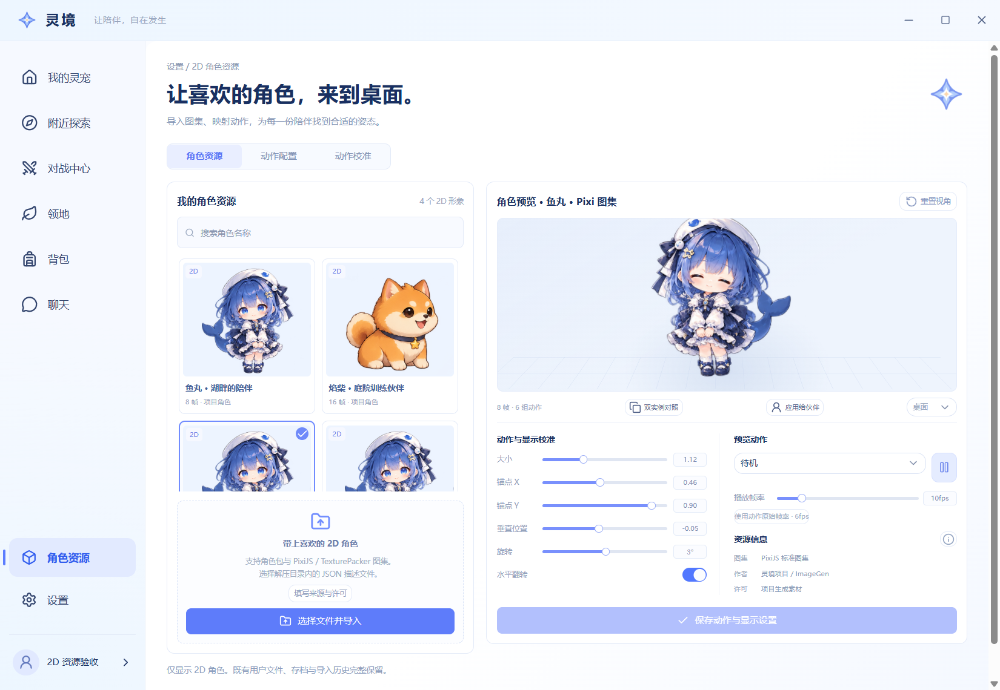
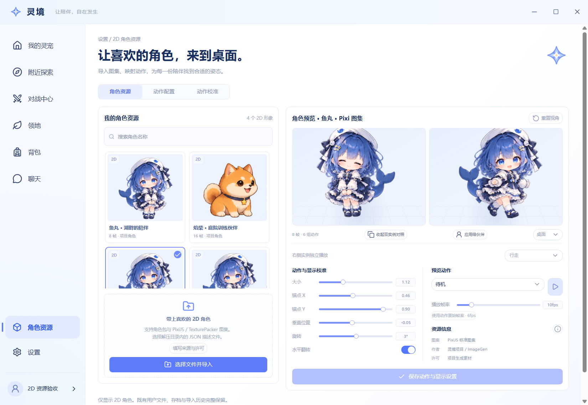

# 2D 资源页图稿对照与验收

当前范围为 `d6a1ab1`，最终代码验收点为 `7a50ef7`。图稿采用 07 下半部分（第 13 页）的资源库、预览和校准结构，按最新要求改为纯 2D。真实截图来自生产构建的 Electron 主窗口，1650 × 1140 物理像素，未绘制替代页面或合成运行状态。

[原图：07 下半部分](../../../../design/2026-10-24/full-ui/07-battle-report-and-model-import.png)

| 对照项目 | 当前实现 |
| --- | --- |
| 页面结构 | 左侧搜索、真实资源卡片和导入区；右侧舞台、动作、校准和保存 |
| 视觉 | 雾白与浅蓝、四芒星标记、项目批准的鱼丸图集、Lucide 图标、无阴影和位移的按钮 |
| 范围调整 | 图集 JSON、FPS、锚点、二维旋转、缩放、翻转、动作映射；旧三维导入与视角控件退出活动流程 |
| 真实资源数量 | 最终基础分支提供两个项目角色，加上两个经 Windows 原生选择器导入的资源；不伪造展示卡片 |
| 公共组件 | foundation 官方 shadcn Radix Nova；键盘切换、Esc 焦点返回、6 个有名称的实际 Slider thumb |
| 动画 | 公共 Motion 页面与列表；Pixi 使用实际 Spritesheet/AnimatedSprite；系统与应用动画策略控制实际播放 |

双实例共用同一个实际 Pixi TextureSource，左侧暂停后右侧帧继续变化，petId 分别为 `resource-preview-a` 和 `resource-preview-b`。

Windows 原生选择器成功导入网格角色包与标准 Pixi JSON，保留的资源 ID 分别为 `63a69a0b-f24f-4dab-9203-5185452c597f` 和 `0fcadbc3-f320-4932-ad7b-9d3c2775e3d2`。损坏 JSON 返回“资源描述不是有效的 JSON”，当时的 3 个资源及两个预览均保持不变；后续基础分支增加的项目角色使最终资源数为 4。原生导入截图记录该较早阶段，最终截图和回放报告对应最终基础依赖。

桌面参数由真实控件保存为 scale 1.12、anchorX 0.46、anchorY 0.90、offset -0.05、rotation 3°、mirror true、10fps；技能映射为 wave。SQLite 回读与 Electron 退出重启后的资源 ID、版本 1、校准和动作一致。

证据文件：

- [原生导入截图](2d-native-atlas-import.png)
- [损坏包错误截图](2d-invalid-native-import.png)
- [SQLite 资源、流水与偏好快照](2d-before-restart.json)
- [原生操作和保存重启记录](2d-runtime-evidence.json)
- [最终生产 Electron 回放结果](2d-replay-report.json)
- [图稿对照元数据](ui-comparison.json)

回放脚本为 `runtime/features/resources/verification/smoke.electron.mjs`，要求先在隔离验收存档完成原生导入并生成 SQLite 快照，不模拟文件选择器。该脚本验证持久化、命名滑块、公共组件键盘/Esc、独立播放和实时减少动画，页面与控制台错误均为 0。资源及备份的 10 项针对性检查、UI 类型、资源 lint 和生产构建通过；最终全产品桌面与战斗回归由 foundation 在合并后统一完成。
