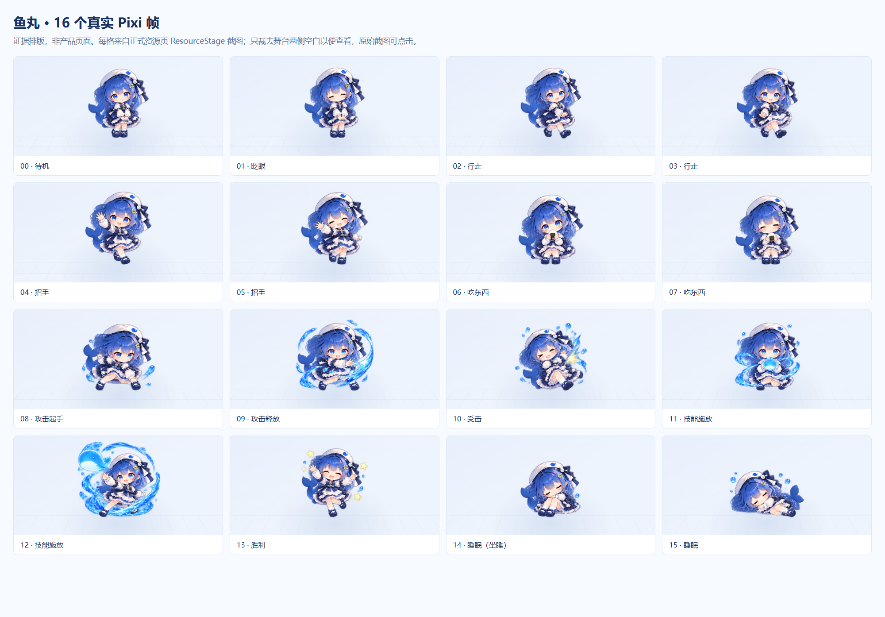
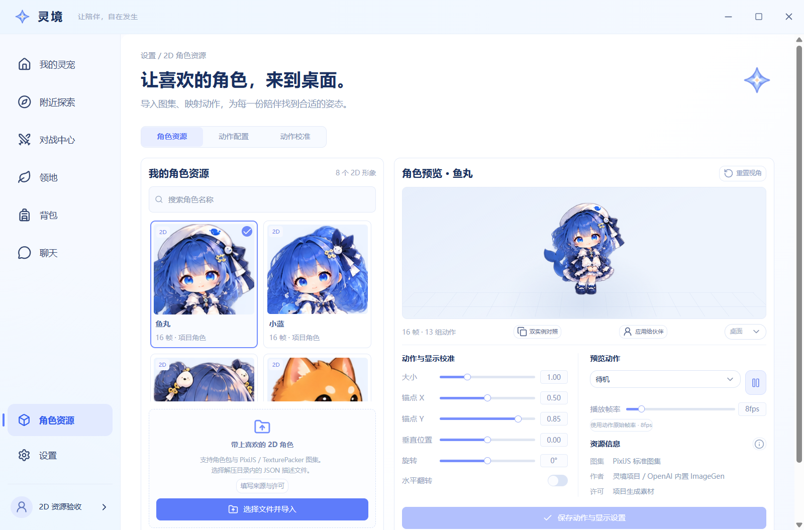

# 六伙伴、真实动作与统一近景构图验收

资源提交 `2d0b5c8`，公共 portrait 契约 `1dac04e`，舞台特效边界修正 `939c254`。本目录的最终运行证据对应 `939c254` 的生产 Electron 构建，使用独立本机测试存档、正式 preload/IPC、真实 SQLite 和 Pixi，未替换为静态产品页面。

[canonical ID、动作和消费方契约](../../../roster-contract.md) · [完整初始提示词](../../../../../apps/pc-app/runtime/features/resources/assets/roster-v2/generation-prompts.json) · [留白修正提示词](../../../../../apps/pc-app/runtime/features/resources/assets/roster-v2/layout-refinement-prompts.json) · [内置 ImageGen 来源及 PNG 哈希](../../../../../apps/pc-app/runtime/features/resources/assets/roster-v2/source-record.json)

六个素材文件分别为 `runtime/features/resources/assets/roster-v2/{yuwan,xiaolan,fantuan,shiba,hatcat,xiaohu}/sprites.png`，每个包同目录的 character.json 保存精确帧区、动作和校准。旧位图、模型目录及原始数据保留。

## 逐帧观察

六角色各 16 个实际纹理帧均通过正式资源页的动作选择与播放/暂停控件捕获。每个角色实际使用 16 个不同 Pixi Texture，16 帧共享同一 TextureSource；所有 96 个默认校准下的绘制区域都在舞台内，最小顶部留白约 10.4 CSS px。攻击 8/9、受击 10、技能 11/12、进食 6/7 为独立姿势，未将招手或休息别名当作战斗动作。

| 角色 | 实际 16 帧 | 近景头像 | 正式页 |
| --- | --- | --- | --- |
| 鱼丸 | [逐帧图](yuwan-frames.png) / [可点击原图索引](yuwan-frames.html) | [头像](yuwan-portrait.png) | [1280](yuwan-page-1280.png) |
| 小蓝 | [逐帧图](xiaolan-frames.png) / [索引](xiaolan-frames.html) | [头像](xiaolan-portrait.png) | [1280](xiaolan-page-1280.png) |
| 饭团 | [逐帧图](fantuan-frames.png) / [索引](fantuan-frames.html) | [头像](fantuan-portrait.png) | [1280](fantuan-page-1280.png) |
| 焰柴 | [逐帧图](shiba-frames.png) / [索引](shiba-frames.html) | [头像](shiba-portrait.png) | [1280](shiba-page-1280.png) |
| 礼帽喵 | [逐帧图](hatcat-frames.png) / [索引](hatcat-frames.html) | [头像](hatcat-portrait.png) | [1280](hatcat-page-1280.png) |
| 小狐 | [逐帧图](xiaohu-frames.png) / [索引](xiaohu-frames.html) | [头像](xiaohu-portrait.png) | [1280](xiaohu-page-1280.png) |

逐帧图只是把 16 张真实组件截图排列，明确标注“证据排版，非产品页面”；同目录保留全部 `角色-frame-00..15.png` 原截图。排版仅去掉舞台左右空白便于看清，未生成或补画任何动作。完整实际区域、纹理 ID、绘制边界、截图物理尺寸见 [evidence.json](evidence.json)，人工观察与文件哈希见 [visual-review.json](visual-review.json)。

最终检查未见主体、帽耳、尾巴、主要特效被截断或相邻角色串入。alpha 边界统计只作辅助，不替代画面。源 PNG 仍为 1254×1254，未按阈值抹图；Pixi 元数据精确分出 16 个区域并统一 512×512 逻辑帧、脚底 435 与 anchor=(0.5,435/512)。源码中的 equal-grid 313.5px 切法不是本包采用的分帧方式。[只读区域诊断](source-region-inspection.json) 保存了最终实际区域。早期 Electron zoom 1.5 的局部截图坐标偏移已被发现并排除；交付的是原生 zoom 1、通过物理尺寸断言的最终截图。

## 近景、独立实例与持久数据

`ResourcePortrait` / `resolveResourcePortrait` 使用同一 canonical 待机位图，按真实帧主体取头部、上身近景。资源卡已接入；领养/详情、聊天、HUD 的消费方按公共契约接入。正常桌面和战斗舞台仍全身，没有全局放大或另生成一套头像。

双实例用相同资源但不同 petId，实际 TextureSource 相同，左侧暂停时 Texture 不变，右侧行走在两个 Texture 间切换。普通攻击实测经过源帧 8→9→0。[播放与 portrait 数据](portrait-and-playback.json) · [双实例截图](yuwan-independent-instances.png)。

[SQLite 只读回读](sqlite-readback.json) 确认 6 个新 canonical 资源、2 个保留的旧内置资源、2 条原导入流水；数据库共 10 资源行，UI 显示 6 canonical + 2 导入，旧 ID 的列表折叠不等于删除。此轮动作映射只在未保存草稿中检查后放弃，没有给新 canonical 资源写偏好。

标准布局为 [1280×844](resource-layout-1280.png) 与 [1440×900](resource-layout-1440.png)，DPR=1.25，未整体缩放页面。实际主标题为 28px/700，卡片标题为 16px/600，继承公共中文字体；6 个实际 Slider thumb 保留可访问名称。计算样式在 evidence.json 的 views 中。

## 定向检查与范围

资源、导入保留、动作和备份的首轮 14 项针对性检查通过；补入 Git LF/CRLF 用例后，最新 roster 套件 5/5 通过。UI 类型、资源 lint 和生产构建通过。最终实际逐帧脚本 6 角色、96 帧通过，页面/控制台错误均为 0。

重放入口：`runtime/features/resources/verification/roster-preview.electron.mjs`；要求在隔离验收存档已有本机测试会话。该脚本只允许 artifacts/resources 内的验收存档，不模拟 preload 或创建用户数据。它用真实公共控件切帧，临时将睡眠映射到坐睡后放弃修改，并为每帧断言实际纹理区域与舞台边界。

本交付完成 resources 的 A07/A08/A12 和公共 portrait API；foundation 统一集成 consumers，并进行请求中的缩略图/HUD 小范围独立复验。这里不以 producer 截图数量代替主会话的最终跨页面验收。
